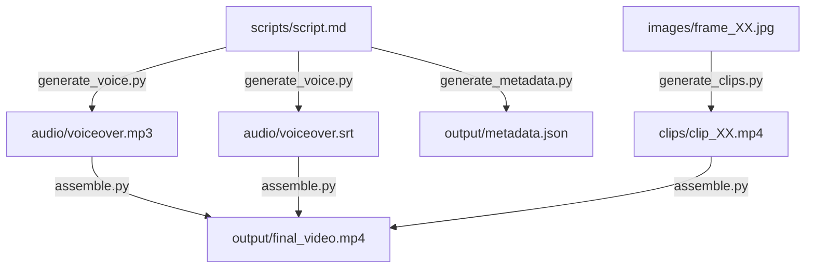

# 🎬 Faceless YouTube Content Engine

[](https://www.python.org/downloads/)
[](https://ffmpeg.org/)
[](LICENSE)
[](https://youtube.com/shorts)

An automated, **100% free**, local AI & CLI-driven video production pipeline that transforms raw scripts or ideas into complete, high-retention **YouTube Shorts (9:16 vertical)**, **TikToks**, and **Instagram Reels** — with zero paid third-party API dependencies.

---

## ✨ Features

- **💸 100% Free & Local-First:** No ElevenLabs, OpenAI, Pexels, or paid SaaS subscription required. Everything runs locally on your machine.
- **🎙️ Neural AI Voiceover (`edge-tts`):** Crisp, studio-quality speech synthesis with automatic SubRip (`.srt`) timestamp generation. Choose between multiple natural voices and accents (US, UK, etc.).
- **📱 Built for YouTube Shorts & Viral Formats:** Native **1080x1920 vertical** output formatted for high completion rate and sub-60-second retention.
- **🎥 Dynamic Camera Motion (Ken Burns & Pop Animation):** Automatically generates animated MP4 scenes using FFmpeg filtergraphs with pop-in bounce, zooms, and cinematic pans.
- **💬 Auto-Formatted Burned-In Subtitles:** Hardcoded captions anchored cleanly to the bottom third (`MarginV=70`), styled with word-wrap guards to prevent overflow and black artifacting.
- **🏷️ Automated YouTube SEO Metadata:** Automatically outputs high-CTR video title options, descriptions, hashtags, and thumbnail concepts to `output/metadata.json`.
- **🛠️ Modular CLI Orchestrator:** Run the entire production end-to-end with one command, or execute individual stages step-by-step.

---

## 🏗️ Architecture



---

## 📁 Repository Structure

```
├── scripts/
│   └── script.md            # Raw script with scene markers & narration
├── audio/
│   ├── voiceover.mp3        # Neural voiceover audio
│   ├── voiceover.srt        # Time-aligned subtitles
│   └── spoken_text.txt      # Clean narration text
├── images/
│   ├── frame_01.jpg         # High-resolution visuals for each cut
│   └── ...
├── clips/                   # Rendered animated video clips (.gitkeep)
├── output/
│   ├── final_video.mp4      # Finished 1080x1920 video ready for upload
│   └── metadata.json        # SEO title suggestions, description, hashtags
├── generate_voice.py        # Voiceover & SRT subtitle generator
├── generate_clips.py        # Dynamic motion renderer (FFmpeg)
├── assemble.py              # Compositor for video, audio & burned subtitles
├── generate_metadata.py     # YouTube SEO metadata extractor
├── engine.py                # Master CLI orchestrator
└── requirements.txt         # Python dependencies
```

---

## 🚀 Quick Start

### 1. Prerequisites

Ensure you have **Python 3.10+** and **FFmpeg** installed on your system.

#### macOS:
```bash
brew install ffmpeg python
```

#### Ubuntu / Debian:
```bash
sudo apt update && sudo apt install -y ffmpeg python3 python3-pip
```

#### Windows:
Download FFmpeg from [ffmpeg.org](https://ffmpeg.org/download.html) and add it to your system `PATH`.

---

### 2. Installation

Clone this repository and install the dependencies:

```bash
git clone https://github.com/Rigur-Calypso/faceless-youtube-content-engine.git
cd faceless-youtube-content-engine
pip install -r requirements.txt
```

Verify your setup:
```bash
python3 engine.py --status
```

---

### 3. Add Your Script & Visuals

1. Place your script into `scripts/script.md`. Use scene tags like `[SCENE: visual concept]` to separate sections:
   ```markdown
   # Your Video Title Here

   [SCENE: Visual concept or description for scene 1]
   Your opening hook narration goes here...

   [SCENE: Visual concept for scene 2]
   Your core explanation goes here...
   ```
   ```
2. Place your corresponding image assets (`frame_01.jpg`, `frame_02.jpg`, etc.) into the `images/` directory.

---

### 4. Run the Pipeline

Run the entire pipeline from voiceover to final video assembly with a single command:

```bash
python3 engine.py --run-all
```

Your final video will be rendered to:
```
output/final_video.mp4
output/metadata.json
```

---

## 🛠️ CLI Usage & Advanced Commands

The engine is completely modular. You can inspect or trigger each stage independently:

### Engine Health & Status
```bash
python3 engine.py --status
```

### Stage 1: Generate Voiceover & Subtitles
```bash
python3 engine.py --voice
# Or specify a custom voice:
python3 engine.py --voice --voice-name "en-US-GuyNeural"
```

#### Popular Neural Voices:
| Voice Identifier | Tone / Style |
| :--- | :--- |
| `en-US-GuyNeural` *(Default)* | Natural, conversational, energetic (great for shorts) |
| `en-US-ChristopherNeural` | Authoritative, deep, documentary |
| `en-US-AriaNeural` | Expressive, clear, educational |
| `en-GB-RyanNeural` | Sophisticated British documentary |

### Stage 2: Render Animated Video Clips
```bash
python3 engine.py --clips
```

### Stage 3: Assemble Video & Burn Subtitles
```bash
python3 engine.py --assemble --font-size 22
```

### Stage 4: Generate YouTube SEO Metadata
```bash
python3 engine.py --metadata
```

### Clean Build Artifacts
Reset intermediate files to start a new video:
```bash
python3 engine.py --clean
```

---

## ⚙️ Configuration & Customization

- **Subtitles Positioning:** Configured in `assemble.py` via libass styling:
  - `Alignment=2` (Centered horizontally)
  - `MarginV=70` (Locked cleanly in the bottom safe zone for YouTube Shorts UI)
  - `PlayResX=1080, PlayResY=1920` (Sharp vector rendering on mobile screens)
- **Aspect Ratio:** Default is **1080x1920 (9:16)**. Can be changed to **1920x1080 (16:9)** in `generate_clips.py` and `assemble.py`.

---

## 📄 License

This project is licensed under the [MIT License](LICENSE).
